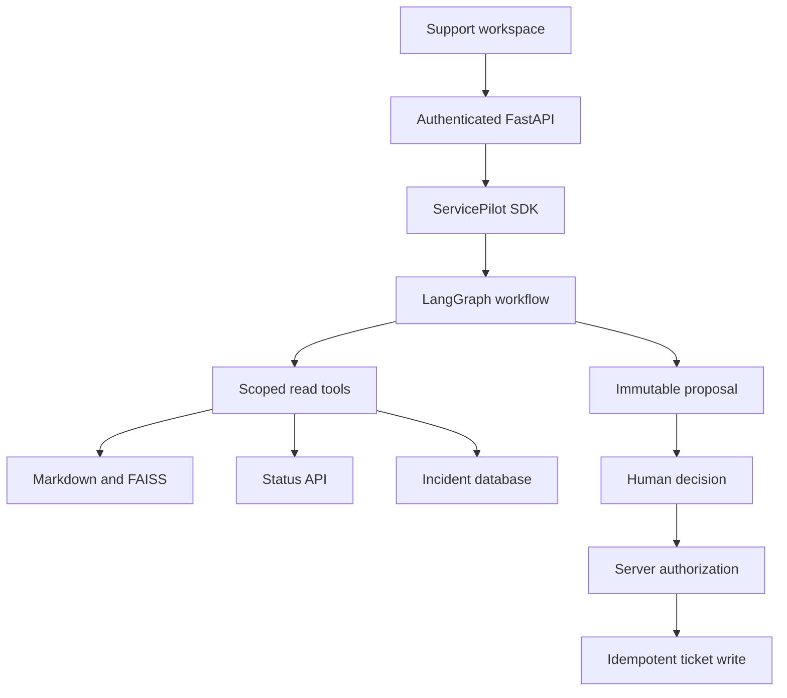

# ServicePilot

**Evidence-driven IT support, with controlled tools and human-approved actions.**

ServicePilot brings support procedures, service health and incident history into one diagnosis. It can prepare a ticket, but only an authenticated human can approve the exact proposed content before the server creates it.

Built as a Python SDK, a LangGraph workflow and a runnable support workspace. All included services, documents, users and incidents are fictional.

## Features

- Search authorized Markdown procedures through a local FAISS index.
- Consult an HTTP status API and an SQLite incident history.
- Return typed diagnoses with sources and next steps.
- Prepare immutable ticket proposals with an owner, digest and expiry.
- Pause a LangGraph run for approval and resume across application restarts.
- Create tickets idempotently, with server-side authorization at execution time.
- Display results, tool traces and approvals in a responsive French-language workspace.
- Run repeatable behavior evaluations, with an optional LLM judge.

## Execution modes

| Mode | Behavior | Credentials |
|---|---|---|
| `offline` (default) | Deterministic rule-based policy driving the real graph and connectors. **No LLM is used.** | None |
| `openai` | LangChain model adapter selects read tools and generates structured diagnoses. | Your own API key |

Retrieval has two options: default `hashing` uses normalized **lexical hashing vectors**, not semantic embeddings. Install the `semantic` extra to use a pretrained sentence-transformer. The UI identifies the active modes.

## Quickstart

Python **3.12** recommended; supported range: 3.11–3.13. From the repository directory:

```bash
python -m pip install uv
uv sync --frozen --extra dev
uv run --frozen servicepilot demo
```

Open **http://127.0.0.1:8000**. This starts the application and a local Python status fixture. No Java, Docker or model API key is needed for this path.

Windows shortcut:

```powershell
powershell -ExecutionPolicy Bypass -File .\scripts\start.ps1
```

Linux/macOS: `bash scripts/start.sh`.

Try these requests:

1. **“Je n'arrive plus à accéder à Atlas. Est-ce un problème connu ?”** — sources, current status and history.
2. **“Quelle procédure pour réinitialiser mon VPN ?”** — documentary answer.
3. **“Crée un ticket pour mon problème de connexion Atlas.”** — review, approve or reject.
4. **“Consulte les rapports Orion.”** as Alice — denied. Switch to Bob to explore his authorized scope.

Demo identities and tokens are intentionally public fixtures for local demonstration.

## Real LLM mode

Copy `.env.example` to `.env` and set:

```dotenv
SERVICEPILOT_PROVIDER=openai
SERVICEPILOT_API_KEY=your-own-key
SERVICEPILOT_MODEL=gpt-4.1-mini
```

Restart the demo. Another OpenAI model can be selected if it supports tool calling and JSON-schema structured outputs. Provider availability and billing depend on your account. Never commit `.env`.

Calls include the redacted request and authorized evidence. Use fictional data; the built-in redactor is limited and does not provide comprehensive data-loss prevention.

Optional semantic retrieval:

```bash
uv sync --frozen --extra dev --extra semantic
```

```dotenv
SERVICEPILOT_EMBEDDING_BACKEND=sentence-transformers
```

The first semantic run downloads a model. Model weights are not bundled.

## Architecture



Only read tools are exposed to the model. Ticket creation is an explicit graph step protected by an independent SQLite approval ledger. Model output cannot grant permission.

## SDK example

```python
from servicepilot import Principal, ServicePilot

user = Principal(user_id="alice", services=frozenset({"atlas", "vpn"}))
with ServicePilot() as pilot:
    run = pilot.run("Quelle procédure pour réinitialiser mon VPN ?", user)
    print(run.answer.summary)
```

`Principal` must come from a trusted application identity layer. The API derives it from the bearer token, never from the request body. See [SDK guide](docs/sdk.md) and [examples](examples/).

## Docker Compose

```bash
docker compose up --build -d
docker compose logs -f app
```

This starts the Python application and the **Java 17 status API**. Only the app port is published, bound to loopback. SQLite and checkpoints use a named volume.

```bash
docker compose down
# Explicitly discard demo state:
docker compose down -v
```

## Tests and evaluation

```bash
uv run --frozen ruff check .
uv run --frozen ruff format --check .
uv run --frozen pytest --cov=servicepilot --cov-report=term-missing --cov-fail-under=80
uv run --frozen servicepilot evaluate
uv run --frozen playwright install chromium
uv run --frozen python scripts/browser_smoke.py
uv run --frozen python -m build
```

Evaluation writes JSON and HTML under `reports/`. The default suite uses deterministic fixtures. Passing it does not establish live-model quality or general prompt-injection resistance. Adapter tests use fakes, not paid calls.

Optional model judge, using your configured key:

```bash
uv run --frozen servicepilot evaluate --judge
```

The judge grades offline outputs for groundedness and usefulness. It never replaces deterministic security checks. See [evaluation methodology](docs/evaluation.md).

## CI and release delivery

- **CI:** Python 3.11/3.12/3.13 lint, tests and coverage; browser smoke; Java compilation and HTTP contract; dependency audit; Docker Compose smoke.
- **Release:** a version tag runs checks, builds the Python distributions and clean repository ZIP, attaches them to a GitHub Release, and publishes the app image to GHCR.
- **Updates:** Dependabot for uv, GitHub Actions and Docker.

No cloud account or deployment server is configured. Delivery publishes artifacts and an image; actual server deployment is a separate operation.

## Documentation

| Document | Content |
|---|---|
| [Architecture](docs/architecture.md) | Graph, persistence, boundaries and tradeoffs |
| [SDK/API](docs/sdk.md) | Integration, examples and endpoints |
| [Security](docs/security.md) | Threat model and limits |
| [Evaluation](docs/evaluation.md) | Deterministic checks and optional judge |
| [Operations](docs/operations.md) | Configuration, GitHub, Docker and troubleshooting |
| [Guide français](docs/guide-fr.md) | Walkthrough, code reading and demonstrations |
| [Validation](docs/validation.md) | Checks actually executed for this version |

## Scope

A personal proof of concept, not a production platform. Four support services, one task per run, no multi-turn chat. Run one app process per data directory. Static bearer tokens, local SQLite and a small regex content policy are explicit simplifications. SSO, centralized policy, distributed limits and encrypted state storage are outside this version. Google ADK and a standalone cross-framework evaluation product are not part of this repository.

[MIT License](LICENSE).
